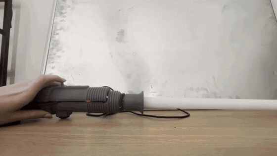
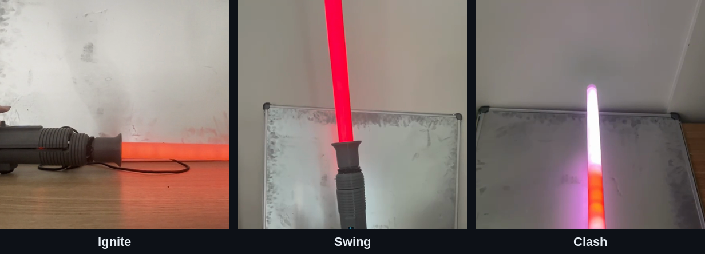
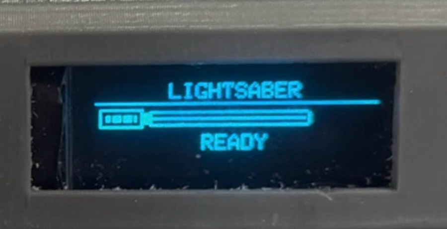
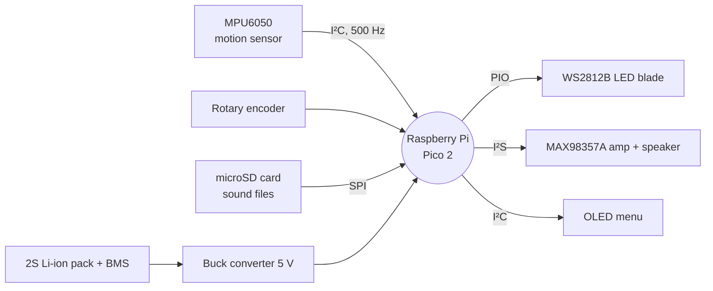

# Motion-Responsive Lightsabre

**A lightsabre that knows where it was hit.**

*Final-year Mechatronic Project 478 · Stellenbosch University · 2026*
*by Cayla Jacobs*

---

## The idea

I've always loved the idea of a lightsabre that feels *alive*: one that hums when
you hold it, whooshes when you swing it and flashes when you hit something. Plenty
of hobby builds already do that. What none of them do is work out **where** on the
blade you hit something.

So that became the challenge for my final-year project: build a lightsabre from
scratch, measure how quickly it actually responds, and teach it to tell a clash at
the tip apart from one near the hilt, using only a single motion sensor hidden in
the handle.

## What it does

- **Ignites and retracts** with a long press on the rotary encoder's push button, with
  the blade filling up LED by LED.
- **Hums, swings and clashes** with SmoothSwing-style audio, where the swing sound follows
  how fast you move. SmoothSwing is an existing lightsabre sound technique, not something
  I invented; [this article](https://sabersourcing.com/2021/08/20/smooth-swing-lightsaber-realistic-motion-sensitivity-technology-explained/)
  explains the idea, and my implementation is in `firmware/Lightsaber_Main`.
- **Finds the clash.** The blade is divided into three equal zones (bottom, middle and
  top), and a classifier running on the Pico 2 decides which zone was hit, so the clash
  glow appears right there.
- **Has a little menu** on a 128 × 32 OLED screen to change colour, brightness, volume,
  idle animation and sensitivity with one rotary knob.

## How it works

When the blade hits something, the hilt responds differently depending on *where* it
was hit. A hit near the tip makes the hilt rotate about the grip more, while a hit near
the hilt mostly pushes it sideways, and each zone also makes the blade vibrate with a
slightly different frequency content. No single measurement separates the three zones
reliably, so instead of looking for a fixed pattern the classifier combines many features
of the acceleration and angular velocity. The firmware grabs a 112 ms window around each clash, computes 74
time- and frequency-domain features, and runs a multinomial logistic regression
model (trained in MATLAB and exported as a C header) to pick the zone. All of
that takes about 5 ms on the Pico 2.

## How well does it work?

I recorded **605 labelled clashes** to train and test the classifier, and measured
every response time with timestamps logged by the firmware itself.

| Test | Result |
|---|---|
| Clash location – cross-validation (534 clashes) | **85.4 %** |
| Clash location – unseen test sessions (71 clashes) | **97.2 %** |
| Clash location – live on the sabre (v1 → v2) | **91.5 % → 96.6 %** |
| Clash → glow in the right zone | **134 ms** on average (target ≤ 200 ms) |
| Swing → sound | **139 ms** on average (target ≤ 200 ms) |
| Battery life | **≈ 5 h** at 55 % brightness (target ≥ 30 min) |

As a sanity check, a model given *only* how hard each clash was scored 43.8 %
(chance is 33 %), so the classifier is truly able to identify where the blade was hit,
not just how hard.

All ten performance tests, with raw logs, spreadsheets and demo videos, are in
[`data/tpm_tests`](data/tpm_tests/).

## Version 2

Testing the first version taught me a lot, mostly by breaking things.

**Shortfalls of version 1**
- The 5 A buck converter limited the blade to 58 % brightness.
- Everything was squashed into the hilt, so material had to be cut away to fit the battery.
- The converter heatsink reached 56 °C at 60 % brightness.
- The epoxy holding the blade gave up after 60 clashes.

**Improvements in version 2**
- A longer hilt (333 mm instead of 303 mm), so everything fits without modification.
- An 8 A buck converter, so the blade runs at full brightness.
- A fan, which keeps the converter heatsink at 33 °C instead of 56 °C.
- A lighter Standard Grade blade, which survived all 605 clashes of the dataset.

## What's in here

| Folder | What you'll find |
|---|---|
| [`firmware`](firmware/) | Overview of the firmware files (start here) |
| [`firmware/Lightsaber_Main`](firmware/Lightsaber_Main/) | The lightsabre firmware for the Pico 2, including the exported classifier `ClashModel.h` |
| [`firmware/ClashLogger`](firmware/ClashLogger/) | The firmware I used to record labelled clashes |
| [`matlab`](matlab/) | Clash capture script and the full training, validation and export pipeline (see its README) |
| [`data/clash_dataset`](data/clash_dataset/) | All 605 labelled clashes |
| [`data/live_test`](data/live_test/) | The live clash test on the sabre |
| [`data/tpm_tests`](data/tpm_tests/) | Every performance test, with logs, spreadsheets and videos |
| [`data/blade_strength`](data/blade_strength/) | Blade joint strength results |
| [`calculations`](calculations/) | The full design calculations (power, battery, structure, heat) as a PDF |
| [`results`](results/) | Classifier figures and test predictions |

## Try it yourself

**You will need**
- Hardware: Raspberry Pi Pico 2, MPU6050, two WS2812B LED strips (60 LEDs/m), MAX98357A
  I²S amplifier with a 4 Ω loudspeaker, microSD card module, 0.91" SSD1306 OLED, rotary
  encoder with push button, 2S 18650 pack with HX-2S-D20 BMS, 5 A or 8 A buck converter,
  power switch and a polycarbonate blade.
- Software: MATLAB (the classifier itself is plain MATLAB; `confusionchart` for the figures needs the
  Statistics and Machine Learning Toolbox) and the Arduino IDE with the
  Raspberry Pi Pico/RP2040/RP2350 board package.
- Arduino libraries: FastLED, Adafruit GFX and Adafruit SSD1306.
- Sound files: 16-bit mono WAV files at 22.05 kHz on the microSD card. I used the free
  sounds from [Hübinette's Free Prop Sounds](https://fredrik.hubbe.net/lightsaber/sound/),
  converted in Audacity. They aren't included here; the firmware expects `hum.wav`, `ignite.wav`,
  `poweroff.wav`, `clash1.wav`, `swingL4.wav` and `swingH4.wav` in the root of the card.

**Steps**

1. Open MATLAB in `matlab/` and run `ClashPipeline.m`. It trains the classifier on
   `data/clash_dataset`, saves the figures to `results/` and exports `ClashModel.h`.
2. Copy `ClashModel.h` into `firmware/Lightsaber_Main/`, open `Lightsaber_Main.ino`
   in the Arduino IDE (Raspberry Pi Pico/RP2040/RP2350 core) and upload it to the Pico 2.
3. Want to record your own clashes? Upload `firmware/ClashLogger/ClashLogger.ino`,
   set `PORT` and `SESSION` in `matlab/CaptureClashes.m` and start swinging.

## What's next

A stronger, mechanically fastened blade mount, a battery level indicator, USB-C
charging built into the hilt, and a much bigger clash dataset with more people
swinging it.

---

Made with a lot of swinging, a few broken blades and plenty of coffee by
**Cayla Jacobs** · Mechatronics Engineering, Stellenbosch University

[LinkedIn](https://www.linkedin.com/in/cayla-jacobs-6b31b03a3/)

