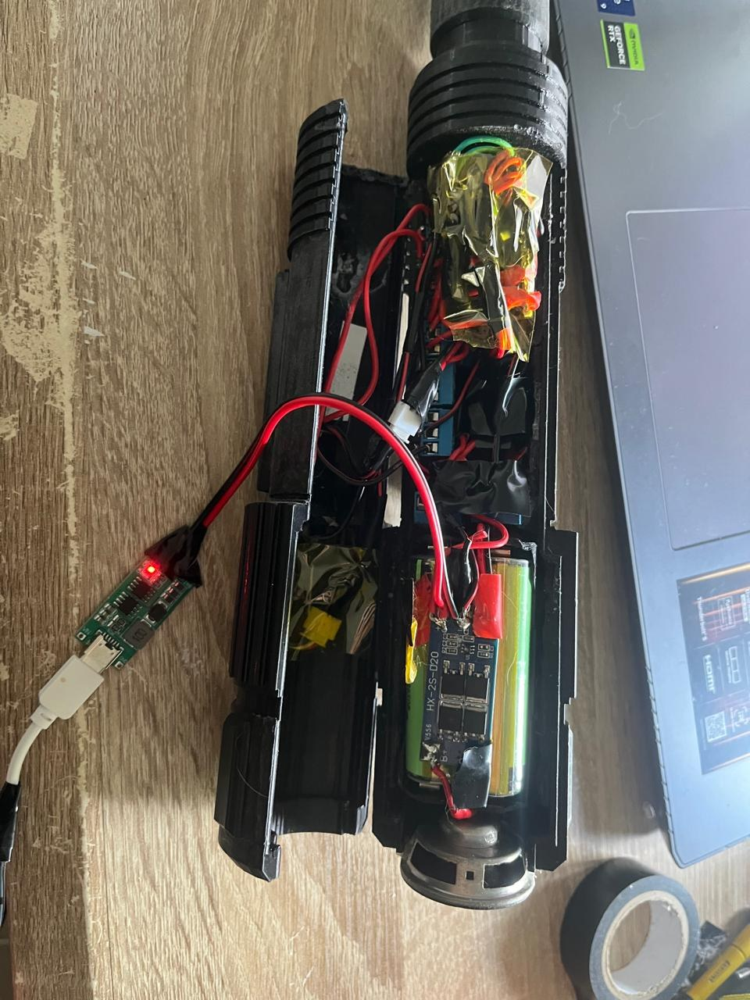
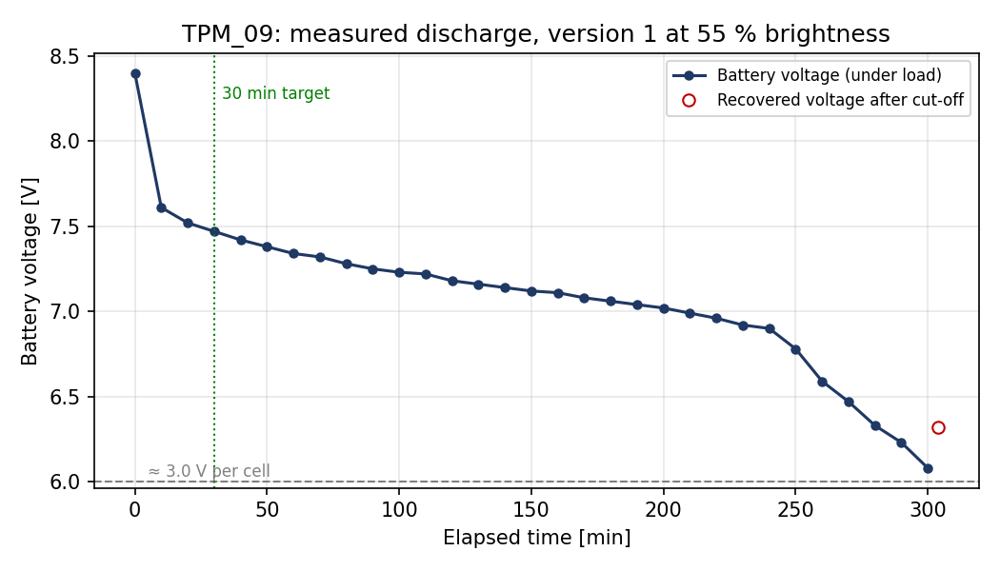

# TPM_09 – How long does the battery last?

**Target:** at least 30 min of continuous use on one charge

| Version | LED brightness | Start voltage | Voltage at cut-off | Running time | Met? |
|---|---|---|---|---|---|
| 1 | 55 % | 8.4 V | 6.08 V | **≈ 300 min (5 h)** | ✅ |

## How the test was done

*The hilt was opened so the battery could be reached, and the 2S pack was charged to 8.4 V with the
external CN3302 charger (red LED on) before the lightsabre was switched on for the test.*

The 2S pack was fully charged to 8.4 V and the lightsabre was switched on with the
default idle animation at 55 % brightness (21 °C ambient). The battery voltage and the
5 V rail were read with a multimeter every 10 minutes until the BMS cut the pack off.

After 300 min the battery reached 6.08 V (about 3.0 V per cell). Shortly after that the
blade started switching on and off: each time the BMS cut the load, the cell voltage
recovered a little (6.32 V at 304 min), the blade came back on and was cut off again.
The test was stopped there, so the running time is taken as 300 min, the last reading
under load. The 5 V rail stayed at 4.88 V for the whole test.

## Why this is longer than the calculation in the report

The calculated operating time (Section 4.6.2) is a worst case that assumes every LED
is lit full white. In this test the blade ran the default idle animation, in which the
pixels run below full brightness, and the firmware's default blade colour is red, so
only one of the three LEDs in each pixel is lit. The average power drawn from the
24.5 Wh pack was therefore only about 5 W.

## Files

| File | Contents |
|---|---|
| `TPM_09_continuous_operating_time.xlsx` | Test log with set-up, readings and summary |
| `TPM_09_continuous_operating_time.csv` | The same readings as plain CSV |
| `TPM_09_discharge_curve.png` | Battery voltage against time |
| `TPM_09_test_setup.jpg` | Photo of the test set-up |
